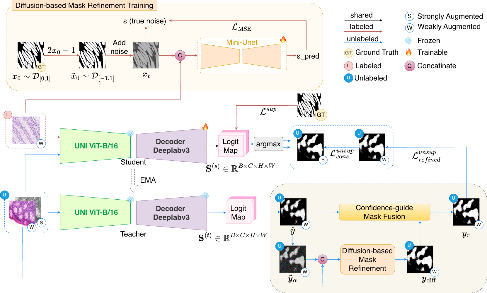
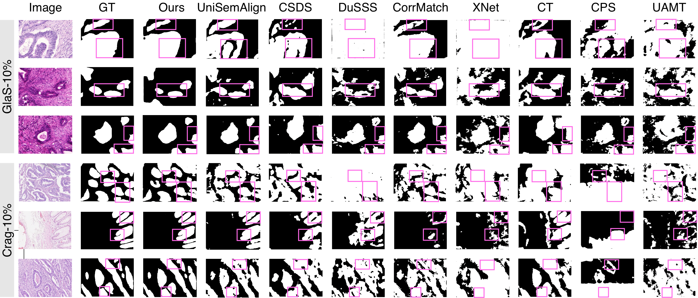

<div align="center">

# CoDiR: Confidence-Guided Diffusion Refinement for Semi-Supervised Histopathology Segmentation

**Hoai Nhan Pham**<sup>1\*</sup> · **Dang-Nguyen Bui**<sup>2\*</sup> · **Le-Van Thai**<sup>1\*</sup> · Thanh-Hiep Vo<sup>3</sup> · Lan Anh Dinh Thi<sup>4</sup> · Tien Dat Nguyen<sup>1</sup> · Duy-Dong Nguyen<sup>1</sup> · Ngoc Lam Quang Bui<sup>5</sup> · Tam Tran<sup>6✉</sup> · Zhi Huang<sup>7✉</sup>

<!-- TODO: add affiliations 1–7 -->
<sup>\*</sup>Equal contribution &nbsp; <sup>✉</sup>Corresponding authors

**MICCAI 2026**

[](static/paper/CoDiR.pdf)
[](https://vongla345.github.io/codir/)
[](https://vongla345.github.io/codir/interactive.html)
[](LICENSE)
<!-- TODO: add arXiv / DOI badge once available -->

</div>

---

> **TL;DR** — Teacher pseudo-labels in semi-supervised histopathology segmentation are wrong exactly where it matters: thin gland bridges and ambiguous boundaries. CoDiR sends **only the low-confidence pixels** through a small conditional diffusion model (SDEdit-style partial noising) to repair them, keeps the confident teacher predictions untouched, and weights the result by teacher–diffusion agreement. Best on **7 / 8** metrics on GlaS and CRAG at 10% and 20% labels.

<p align="center">
  
  <br/><em>Fig. 1. Overview of CoDiR. A Mean Teacher segmentation network (frozen UNI encoder + DeepLabV3 decoder) learns from labeled data and teacher pseudo-labels; a mini-UNet diffusion model, trained on labeled masks in the same loop, refines the low-confidence regions of the teacher pseudo-masks before they are fused back.</em>
</p>

## Highlights

- **Acts on the mask, not only the features.** Prior work (UniSemAlign) improves pseudo-labels indirectly through semantic alignment; CoDiR corrects the erroneous mask regions directly with a learned structural prior `p(y | I)`.
- **Confidence-gated refinement.** A FreeMatch-style adaptive threshold `τ` selects uncertain pixels, `m = 1(c < τ)`. Only those are noised to level `αₙ` and denoised for `K` DDPM steps, so reliable structure is never corrupted.
- **Confidence weighting.** Each pixel's unsupervised loss is weighted by `w = c_teacher · c_diff^eff`, so pixels where teacher and diffusion agree contribute more.
- **Inference is just the student.** The diffusion model is a training-time tool; there is no extra cost at test time.

## Method in one picture

| Step | Symbol | What happens |
|---|---|---|
| 1. Teacher prediction | `ŷ` | EMA teacher produces a soft pseudo-mask for an unlabeled image `I_u` |
| 2. Confidence gate | `m = 1(c < τ)` | `c = max(p, 1−p)`; `τ` is an EMA of batch confidence, clamped to `[0.60, 0.75]` |
| 3. Partial noising | `ỹ_αₙ` | Pseudo-mask is noised to `αₙ = 0.2` (of `T = 100` steps) |
| 4. Diffusion refinement | `y_diff = Denoise_K(ỹ_αₙ; I_u, θ)` | Mini-UNet runs reverse DDPM steps conditioned on the image |
| 5. Fusion | `y_r = m ⊙ y_diff + (1−m) ⊙ ŷ` | Refined pixels where unsure, teacher pixels elsewhere |
| 6. Weighting | `w = c_teacher · c_diff^eff` | Per-pixel weight on the unsupervised loss |

**Objective.** `L = ½ (L_sup + L_unsup)`, with
`L_sup = λ₁ L_CE + λ₂ L_Dice + λ₃ L_clDice + λ₄ L_Boundary` and
`L_unsup = λ_u L_refine + λ_c L_cons` (λ₁ = λ₂ = 1.0, λ₃ = λ₄ = 0.5, λ_u = λ_c = 0.25).

## Results

### Comparison with the state of the art (Table 1)

mDice / mJaccard (%). **Bold** = best, <ins>underline</ins> = second best (fully-supervised excluded).

| Labels | Method | GlaS mDice | GlaS mJacc | CRAG mDice | CRAG mJacc |
|---|---|---|---|---|---|
| 100% | Fully-Supervised | 89.59 | 81.84 | 92.68 | 86.36 |
| 10% | UAMT (MICCAI'19) | 78.57 | 64.70 | 77.85 | 63.74 |
|  | FixMatch (NeurIPS'20) | 66.01 | 51.39 | 72.42 | 64.31 |
|  | CPS (CVPR'21) | 61.70 | 49.34 | 47.10 | 40.77 |
|  | CT (MIDL'22) | 81.75 | 70.44 | 77.33 | 65.56 |
|  | XNet (ICCV'23) | 74.13 | 58.90 | 65.27 | 50.40 |
|  | CorrMatch (CVPR'24) | 85.54 | 74.74 | 79.93 | 66.76 |
|  | DuSSS (AAAI'25) | 75.07 | 61.46 | 64.25 | 49.99 |
|  | CSDS (MICCAI-W'25) | 82.89 | 71.61 | 79.86 | 67.81 |
|  | UniSemAlign (CVPRW'26) | **88.15** | <ins>78.82</ins> | <ins>88.57</ins> | <ins>79.52</ins> |
|  | **CoDiR (Ours)** | <ins>88.09</ins> | **79.41** | **89.83** | **82.46** |
| 20% | UAMT (MICCAI'19) | 77.09 | 62.72 | 79.76 | 66.33 |
|  | FixMatch (NeurIPS'20) | 58.51 | 44.12 | 71.20 | 64.75 |
|  | CPS (CVPR'21) | 75.99 | 63.69 | 52.43 | 45.70 |
|  | CT (MIDL'22) | 85.96 | 76.51 | 81.64 | 70.87 |
|  | XNet (ICCV'23) | 79.56 | 67.50 | 65.60 | 50.85 |
|  | CorrMatch (CVPR'24) | 86.09 | 75.59 | 85.35 | 74.54 |
|  | DuSSS (AAAI'25) | 79.50 | 66.80 | 71.13 | 57.45 |
|  | CSDS (MICCAI-W'25) | 83.50 | 72.87 | 81.28 | 69.67 |
|  | UniSemAlign (CVPRW'26) | <ins>88.58</ins> | <ins>79.50</ins> | <ins>89.40</ins> | <ins>80.88</ins> |
|  | **CoDiR (Ours)** | **89.19** | **81.09** | **90.29** | **82.93** |

Gains are largest on CRAG (+1.26 mDice / +2.94 mJaccard at 10%), whose larger, less regular glands give the refinement step more structural error to correct.

### Qualitative results

<p align="center">
  
  <br/><em>Fig. 2. Predicted masks at 10% labels — GlaS (top three rows) and CRAG (bottom three). Pink boxes mark where methods diverge most.</em>
</p>

### Ablations (GlaS, 10% labels, mean ± std over 3 seeds)

<details open>
<summary><b>Incremental contribution of each module (Table 3)</b></summary>

| Configuration | mDice (%) | mJaccard (%) |
|---|---|---|
| Mean Teacher (UNI + DeepLabV3) | 80.95 ± 0.12 | 69.09 ± 0.79 |
| + Diffusion Refinement | 87.31 ± 0.26 | 78.28 ± 0.40 |
| + Confidence Fusion | 87.50 ± 0.31 | 78.54 ± 0.47 |
| + Confidence Weighting | **88.09 ± 0.32** | **79.41 ± 0.46** |
</details>

<details>
<summary><b>Visual encoder (Table 2)</b></summary>

| Backbone | mDice (%) | mJaccard (%) |
|---|---|---|
| ResNet101 | 65.93 ± 0.15 | 51.10 ± 0.13 |
| ResNet200 | 74.75 ± 0.10 | 60.64 ± 0.11 |
| MedCLIP | 72.65 ± 0.17 | 58.47 ± 0.23 |
| CONCH | 78.89 ± 0.04 | 66.55 ± 0.14 |
| **UNI** | **88.09 ± 0.32** | **79.41 ± 0.46** |
</details>

<details>
<summary><b>Sensitivity: threshold τ_max, noise level αₙ, EMA decay d (Tables 4–6)</b></summary>

| τ_max (τ_min = 0.60) | mDice (%) | mJaccard (%) |
|---|---|---|
| 0.70 | 87.70 ± 0.05 | 78.89 ± 0.16 |
| **0.75** | **88.09 ± 0.32** | **79.41 ± 0.46** |
| 0.80 | 87.98 ± 0.39 | 79.29 ± 0.62 |

| αₙ | mDice (%) | mJaccard (%) |
|---|---|---|
| 0.05 | 87.07 ± 0.09 | 77.88 ± 0.14 |
| 0.10 | 87.98 ± 0.39 | 79.29 ± 0.62 |
| **0.20** | **88.09 ± 0.32** | **79.41 ± 0.46** |
| 0.40 | 87.61 ± 0.69 | 78.67 ± 0.05 |
| 0.60 | 87.86 ± 0.38 | 79.05 ± 0.33 |

| EMA decay d | mDice (%) | mJaccard (%) |
|---|---|---|
| 0.90 | 87.65 ± 0.18 | 78.78 ± 0.19 |
| **0.99** | **88.09 ± 0.32** | **79.41 ± 0.46** |
| 0.995 | 87.22 ± 0.05 | 78.14 ± 0.13 |
| 0.999 | 87.42 ± 0.06 | 78.35 ± 0.13 |
</details>

## Implementation details

| Item | Setting |
|---|---|
| Datasets | GlaS (165 images), CRAG (213 images); 10% / 20% labeled |
| Encoder / decoder | Frozen UNI ViT-L/16 (d = 1024) / DeepLabV3-style ASPP decoder |
| Training | 100 epochs, AdamW (lr 1e-4), batch 16, 10-epoch warm-up, EMA d = 0.99 |
| Input | 256 × 256 for training; non-overlapping patches stitched at inference |
| Diffusion | T = 100, αₙ = 0.2, mini-UNet trained on labeled masks only |
| Hardware | 1 × NVIDIA RTX PRO 4000 Blackwell (24 GB) |

## Code

> 🚧 Training and evaluation code will be released in this repository. <!-- TODO: replace once code is public -->

## Interactive explainer

[`interactive.html`](interactive.html) is a 12-part interactive "optical bench" of the CoDiR pipeline. You can drag `τ`, `αₙ` and `K` and watch the pseudo-label change from the teacher output to the final refined mask. Open it locally in a browser or on the [project page](https://vongla345.github.io/codir/interactive.html).

## Repository layout

```
.
├── index.html             # Project page (served by GitHub Pages)
├── interactive.html       # Interactive pipeline explainer
├── static/
│   ├── css/style.css
│   ├── js/main.js
│   ├── images/            # Paper figures
│   └── paper/CoDiR.pdf
├── CITATION.cff
└── LICENSE
```

## Citation

```bibtex
@inproceedings{pham2026codir,
  title     = {CoDiR: Confidence-Guided Diffusion Refinement for Semi-Supervised Histopathology Segmentation},
  author    = {Pham, Hoai Nhan and Bui, Dang-Nguyen and Thai, Le-Van and Vo, Thanh-Hiep and Dinh Thi, Lan Anh and Nguyen, Tien Dat and Nguyen, Duy-Dong and Bui, Ngoc Lam Quang and Tran, Tam and Huang, Zhi},
  booktitle = {Medical Image Computing and Computer Assisted Intervention (MICCAI)},
  year      = {2026}
}
```

## Acknowledgements

CoDiR builds on [UNI](https://github.com/mahmoodlab/UNI), [Mean Teacher](https://arxiv.org/abs/1703.01780), [DDPM](https://arxiv.org/abs/2006.11239), [SDEdit](https://arxiv.org/abs/2108.01073) and [FreeMatch](https://arxiv.org/abs/2205.07246). Baseline numbers follow the protocol of UniSemAlign.
